

<a href="https://slothmod.com/">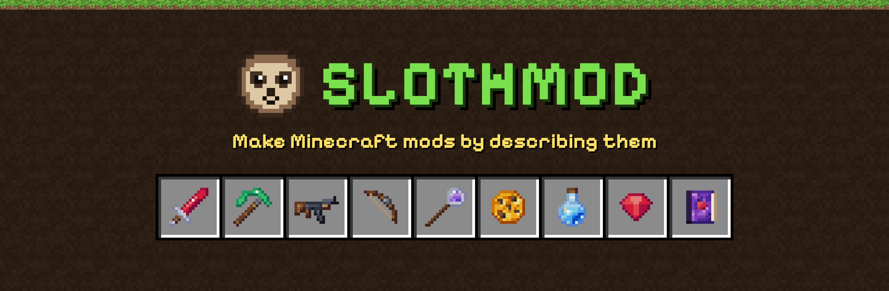</a>

<h3>Describe a Minecraft mod, world, city or full survival overhaul in plain English — or craft it visually by hand at zero AI cost. SlothMod plans it, builds it and gets it ready to play.</h3>

Free for Windows · works with any AI, cloud or local · no coding required, full 3D Studios & Code mode included

[Website](https://slothmod.com/) · [New in 1.0](#new-in-10) · [Showcase](#showcase) · [First mod in 3 steps](#your-first-mod-in-3-steps) · [Versions and AIs](#what-it-works-with) · [Install](#install) · [Help](#help-and-feedback) · [Support](#support-slothmod)

 

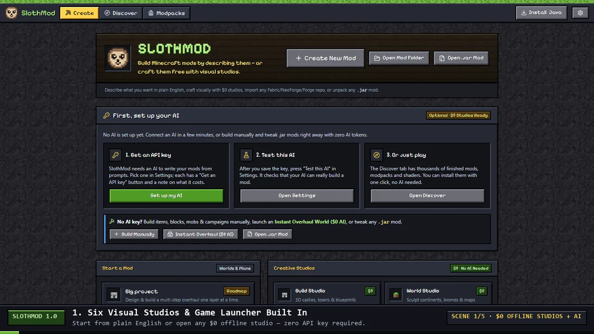

## Make a mod in 3 steps

1. **Install & open SlothMod** on Windows 10 or 11 (Java & Gradle set themselves up automatically on your first build).
2. **Describe your idea in plain words** with any cloud or local AI — **or build by hand at `$0` AI cost** in World Studio, Build Studio, Game Studio, Brain Studio, Colony Studio, Theme Studio, or Manual Creator.
3. **Click Test in Minecraft** to try your mod in-game before keeping changes, then export a `.jar` or publish to Modrinth.

## What it does

- **Sculpts playable 3D worlds & existing `.mca` saves (`$0` AI).** Roll continents and islands, paint biomes and rivers, convert a drawing or real-world map area, or open an existing Minecraft save (`.mca`). Fly over stepped 3D voxel terrain at `1:1` block zoom, sculpt terrain, lakes and forests live across 3D & 2D with Undo/Redo, and move, rotate, copy, bulldoze or send buildings into **Build Studio**.
- **Builds ornate 3D architecture, scenes & craftable in-game Blueprint scrolls.** Compose cottages, castles, cathedrals, solarpunk towers, skybridges and terraced hillside or cliff scenes from plain English (with an optional 2-call 3D look review), a free floor-plan sketch, a reference photo, `.nbt`/`.schem`/`.litematic` schematics or `$0` starters — with 3D facades, orientation-preserving wood/stone family swaps, automatic 16-room furnishing, `512+`-block mega-structures and in-game Blueprint scrolls with ghost preview, `90°` turn, build and undo.
- **Brings towns, NPC minds & self-building Colonies to life (`$0` AI).** Design townsperson personalities, priorities, memories, relationships, patrol routes and squad orders in **Brain Studio** with a live 24-hour Calm Day vs Storm & Raid simulator and optional live AI companions — or found player-run **Colonies** in **Colony Studio** with a Town Hall, Build Scepter, `Lv 1–3` builders, warehouses, couriers, worker huts, colonist traits/moods, painted zones, a `1–4` job priority grid and dynamic Storyteller events.
- **Composes whole games, RPG campaigns & total conversions.** Design complete survival overhauls in **Game Studio** (or play and remix 8 `$0` **Instant Overhaul Worlds** from fresh spawn to boss victory) with living world chronicles & rival promotions, seasons & dynamic markets, town banks/laws/elections, tabletop Game Master scepters & multi-lane Tower Defense, Capture Orbs & genetics, rideable 8-element dragons, breakable-limb bosses, guns/staffs/spell wheels, dodge/parry/grapple/wall-run/morphs/time-stop, moving multi-block ships & elevators, conveyors/power grids/rail signals/pressurized habitats, stealth & Spirit Camera mysteries, and playable 24-note instruments.
- **Shapes your mod's complete visual theme, 3D props, animations & soundtracks.** Set your mod's colours, materials, wear, glow and `8×8` custom pixel stamps on a live 6-card pixel-art sheet in **Theme Studio**; sculpt 3D props and weapons box-by-box (`1 px` or `1/4 px` snap); paint directly onto 3D models with smart material brushes (`Scales`, `Crystal`, `Metal`, `Fur`, `Rune Glow`) synced to `F3+T`; animate creatures on a `0–200` tick **Keyframe Timeline** (with `.bbmodel` / `.animation.json` import); and generate 614 sound types plus seamless area & boss music.
- **Adds biomes, dimensions, portals, dungeons, dialogue, cutscenes, commands & rules (`$0` AI).** Spin live 3D block dioramas for custom biomes, multi-biome dimensions, standing `4×5` portals and branching multi-room dungeons; wire branching conversations with `d20` skill checks, camera cutscenes, quests, slash commands, advancement trees, custom game rules, villager professions, survival world rules, custom workstations and full wood-set trees offline with zero AI calls.
- **Reopens `.jar` mods, exports Overlay Packs, wires Visual Blueprints & includes Code mode.** Click **Open `.jar` Mod** to reopen any SlothMod `.jar` with its full project, custom art, Blueprints and code intact, or open another Fabric, NeoForge or Forge `.jar` to tweak textures, sounds and recipes and export a clean `.zip` Overlay Pack. Switch anytime between **Visual Blueprints**, plain-English sentences and dark-theme Java **Code** mode.
- **Tests before anything is kept — and manages your mods too.** One button starts Minecraft with your mod, an automatic in-game check tries your new content before you keep it, **Sync to Game (`F3+T`)** pushes live art changes without restarting, and the built-in **Modrinth** manager handles mods, modpacks, resource packs, shaders and game profiles.

## New in 1.0

<table>
  <tr>
    <td width="50%" valign="top">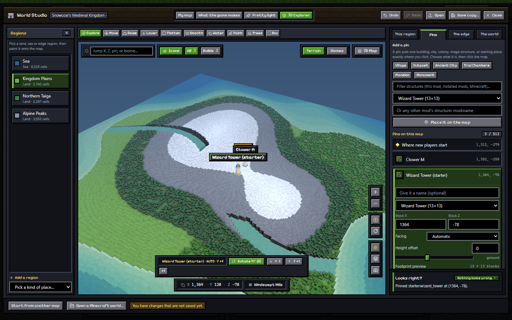 <b>World Studio 3D Voxel Explorer &amp; Live Sculptor (<code>$0</code> AI).</b> Fly over stepped 3D voxel terrain with <code>1:1</code> block zoom, seafloor depth, shadows &amp; Pretty Light — sculpt mountains, rivers, surfaces &amp; forests live across 3D &amp; 2D, and drag-move, rotate, copy, bulldoze or extract buildings from <code>.mca</code> saves.</td>
    <td width="50%" valign="top">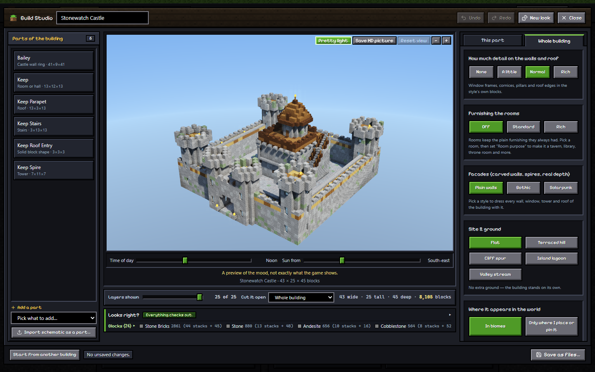 <b>Build Studio Architecture, Room Furnisher &amp; Blueprint Scrolls.</b> Design buildings &amp; cliff/hillside scenes from English, a free sketch, a reference photo, <code>.nbt</code>/<code>.schem</code>/<code>.litematic</code> schematics or <code>$0</code> starters — with 3D facades, smart wood/stone swaps, 16-room furnishing &amp; craftable in-game Blueprint scrolls.</td>
  </tr>
  <tr>
    <td width="50%" valign="top">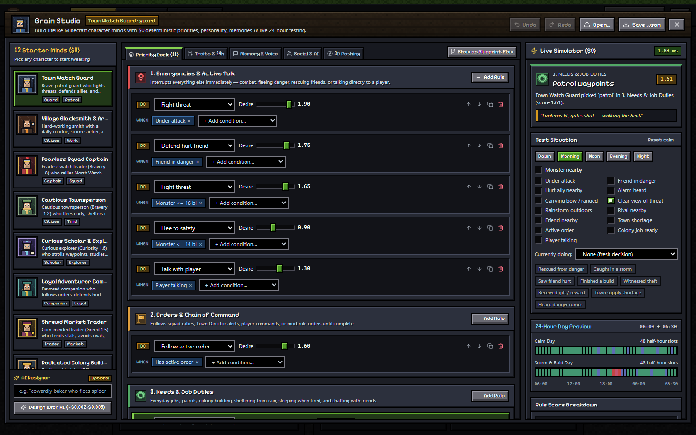 <b>Brain Studio &amp; Living Colony Studio (<code>$0</code> AI).</b> Shape NPC priorities, unclamped personalities, memories, relationships &amp; 24-hour schedules with 12 pixel-art starter minds, or build self-building player Colonies with Town Halls, <code>Lv 1–3</code> builders, traits/moods, painted zones, <code>1–4</code> work priorities &amp; Storyteller events.</td>
    <td width="50%" valign="top">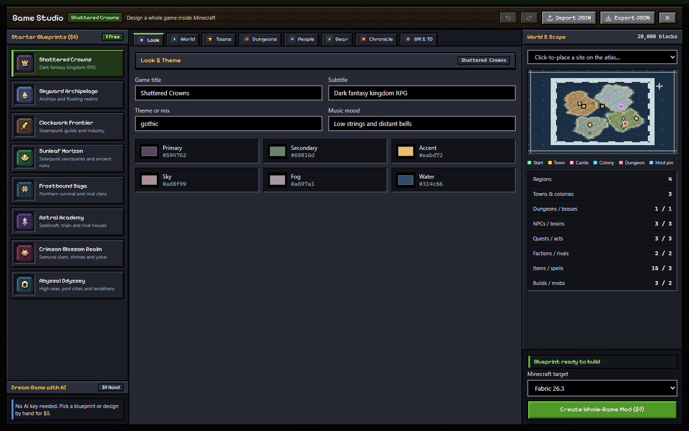 <b>Whole-Game Studio &amp; Theme Studio (<code>$0</code> AI).</b> Compose complete survival overhauls with living chronicles, rival warlords, seasons, markets, tabletop Game Master scepters &amp; multi-lane Wave Defense — and style your entire mod's palette, materials &amp; <code>8×8</code> stamps on a live 6-card pixel-art sheet.</td>
  </tr>
</table>

- **World Studio & Live 60 fps 3D Voxel Terrain Sculptor (`$0` AI).** Roll continents and islands, paint custom biomes and rivers, import drawings, real-world OpenStreetMap + elevation areas or existing Minecraft saves (`.mca`), explore stepped 3D voxel worlds at `1:1` block zoom with underwater seafloor depth and **Pretty Light** mood lighting, sculpt terrain, water, 8 surface materials and trees live in 3D & 2D with full Undo/Redo, and drag-move, `90°`-rotate, copy, bulldoze or send existing buildings straight into **Build Studio**.
- **Build Studio, Ornate Facades, Room Furnisher & In-Game Blueprint Scrolls.** Build cottages, castles, cathedrals, solarpunk enclaves and terraced hillside scenes from plain English (with optional 2-call 3D look review), a free floor-plan sketch, a reference photo, `.nbt`/`.schem`/`.litematic` schematics or `$0` starters; swap whole wood or stone families while keeping stair/door orientations; furnish 16 room types automatically; place `512+`-block mega-structures; and hand players craftable in-game Blueprint scrolls with ghost preview, `90°` turn, ground-up build and undo.
- **Brain Studio, Living Towns & Self-Building Colonies (`$0` AI).** Tune 12 pixel-art starter minds across Priority Decks, unclamped personality sliders, episodic memories, relationships, patrol routes and a live 24-hour Calm Day vs Storm & Raid simulator (plus optional live AI companions), and run player **Colonies** with Town Halls, Build Scepters, `Lv 1–3` builders, warehouses, couriers, worker huts, colonist traits/moods, painted stockpile/grow/bunker zones, a `1–4` manual priority matrix and dynamic Storyteller events.
- **Whole-Game Studio, Theme Studio & Total-Conversion Gameplay.** Build start-to-finish survival overhauls in **Game Studio** (or remix 8 `$0` Instant Overhaul Worlds) with living world chronicles & rival promotions, seasons & dynamic markets, town banks/laws/elections, Game Master scepters & multi-lane Tower Defense, Capture Orbs & genetics, rideable 8-element dragons, breakable-limb bosses, guns/staffs/spell wheels, dodge/parry/grapple/wall-run/scale morphs/time-stop, moving multi-block ships & elevators, conveyors/power grids/rail signals/pressurized habitats, stealth & Spirit Camera mysteries, and playable 24-note instruments — all styled cohesively in **Theme Studio** (`12` colour swatches, material/wear/glow controls and custom `8×8` pixel stamps).
- **Still being polished.** `Fabric 26.3` and `NeoForge 26.3` are the lead targets with real Gradle builds, dedicated-server verification, live client sessions and automatic in-game mod checks; all six supported targets (`26.3`, `1.21.1`, `1.20.1`) compile real `.jar` mods. Natural World Studio terrain generation, the newest dragon riding/camera features and some visual polish lead on `26.3`, while `1.21.1` and `1.20.1` receive features in batches with plain notes inside the app. Full unassisted multiplayer playthroughs across every overhaul system are still being fine-tuned in real play. Use **Report a problem** inside the app if something acts up.

### Also included in SlothMod 1.0

<table>
  <tr>
    <td width="50%" valign="top">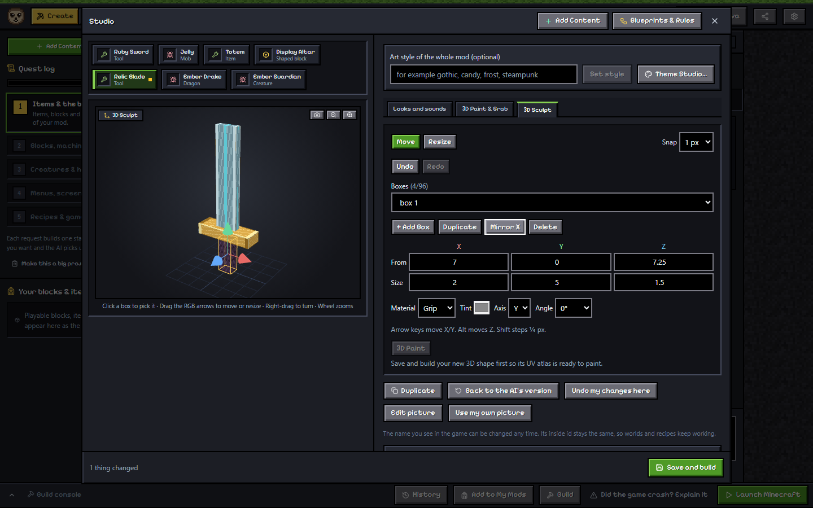 <b>In-App 3D Sculptor &amp; 3D Paint.</b> Drag RGB move/resize handles (<code>1 px</code> or <code>1/4 px</code> snap) to sculpt shaped blocks, furniture, items &amp; 3D weapons box-by-box, then paint straight onto 3D surfaces with smart material brushes synced to <code>F3+T</code>.</td>
    <td width="50%" valign="top">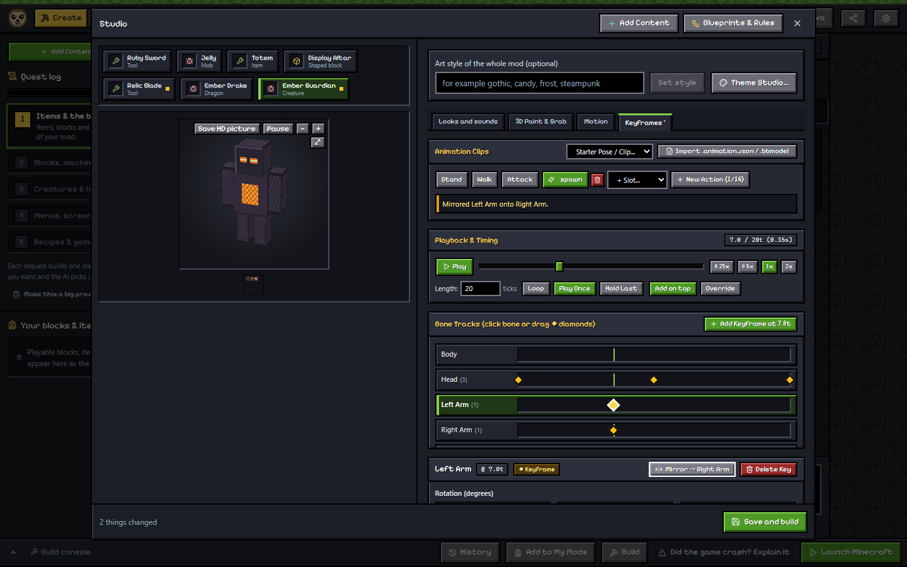 <b>Keyframe Animation Timeline &amp; Clip Import.</b> Scrub <code>0–200</code> ticks across per-bone tracks, add custom actions like <code>spawn</code>, mirror left/right limbs, and import <code>.bbmodel</code> / <code>.animation.json</code> clips across all 6 targets.</td>
  </tr>
  <tr>
    <td width="50%" valign="top">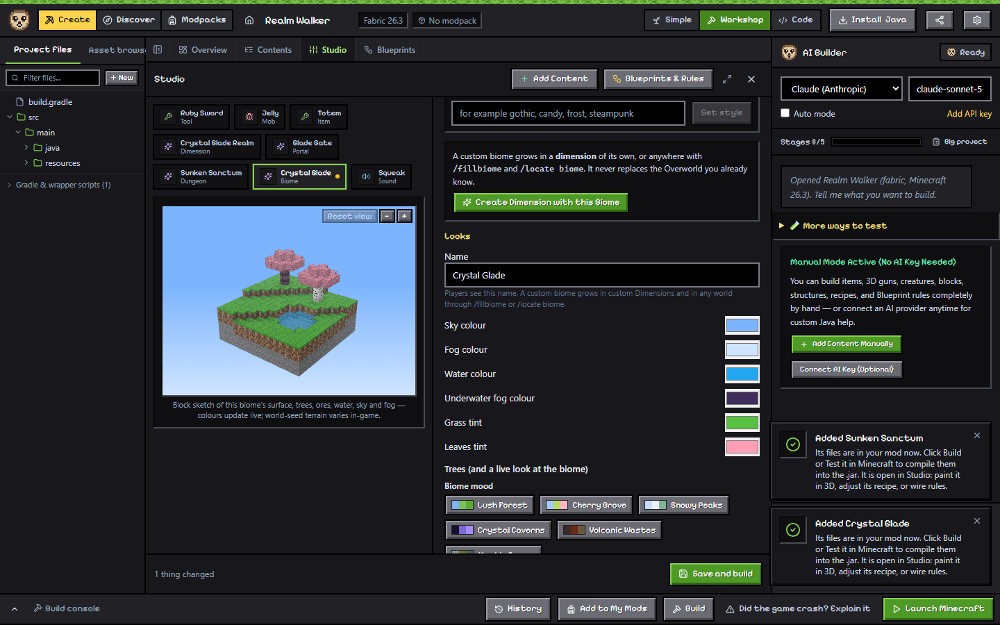 <b>3D Biome, Portal, Dungeon &amp; Dimension Dioramas (<code>$0</code> AI).</b> Spin live 3D block dioramas with 60 fps sky, fog, water &amp; leaf tinting, combine 1–8 biomes per dimension, and generate branching multi-room dungeons with explorer maps.</td>
    <td width="50%" valign="top">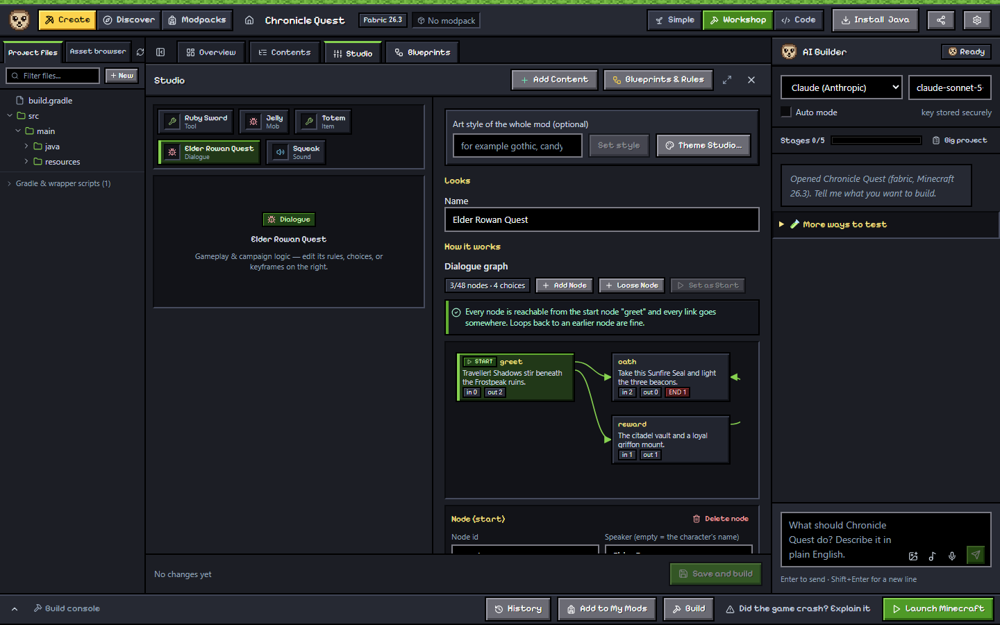 <b>Dialogue Graphs, Cutscenes, Commands &amp; Professions (<code>$0</code> AI).</b> Wire 48-node branching conversations with <code>d20</code> checks, camera cutscenes, 8-style seamless area music, slash commands, advancement trees, game rules &amp; villager professions.</td>
  </tr>
</table>

## Showcase

Everything here was drawn by SlothMod's own art engine, the one that makes the art in your mods. No image generator, no Minecraft art, nothing touched up by hand. You can turn each one yourself, and hear the sound maker, on the [website](https://slothmod.com/#showcase).

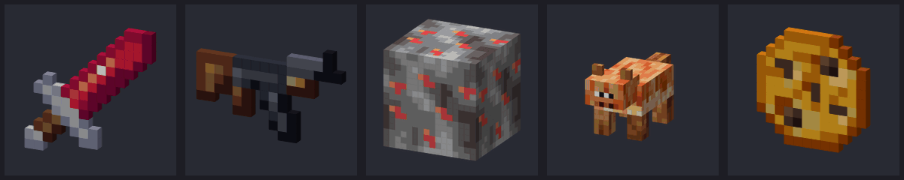

<table>
  <tr>
    <td width="50%" align="center">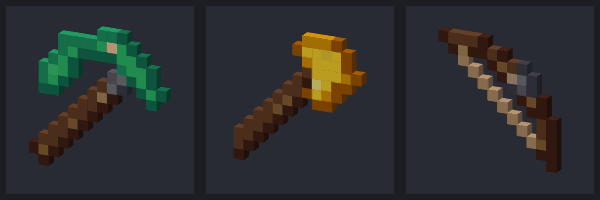 <b>Tools and weapons</b></td>
    <td width="50%" align="center">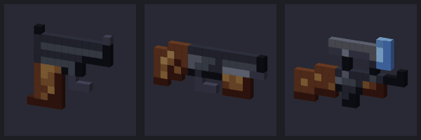 <b>Guns</b></td>
  </tr>
  <tr>
    <td colspan="2" align="center">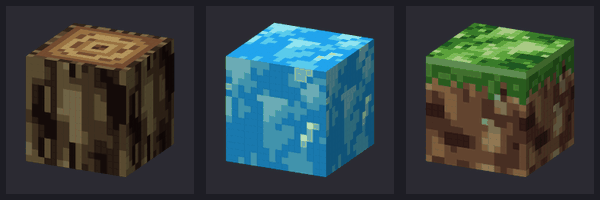 <b>Blocks</b></td>
  </tr>
</table>

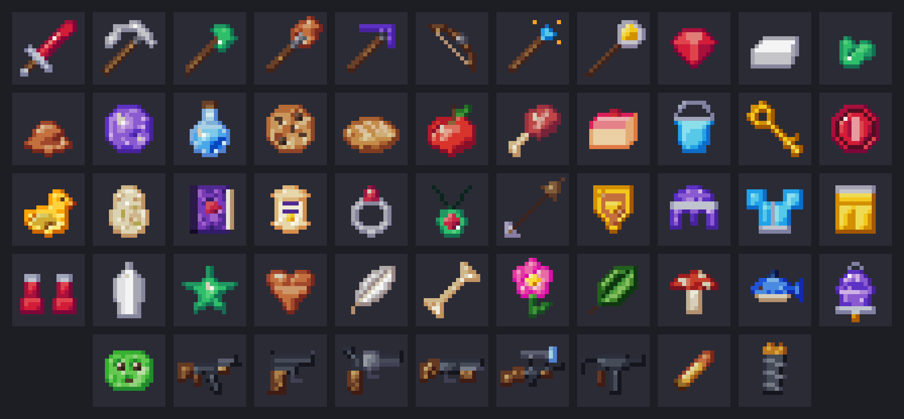 
<b>Every item shape the engine knows.</b> You choose the material and the colors.

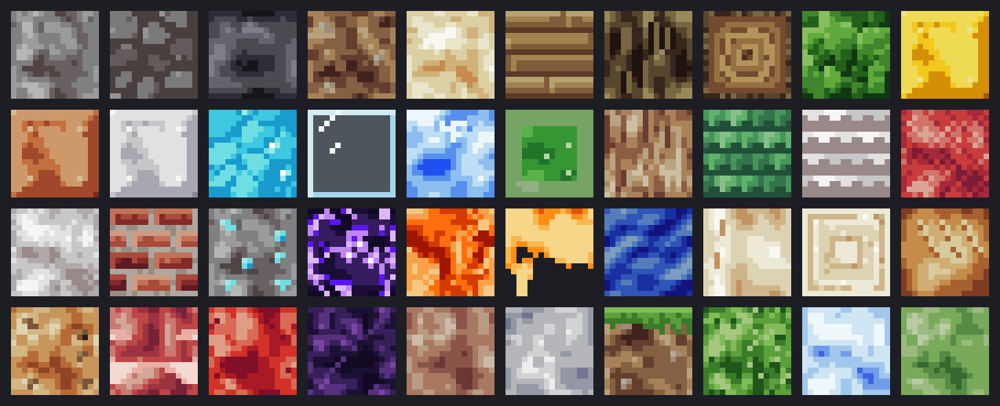 
<b>Every block material the engine knows</b> (with separate tops for logs, bone and grass). They tile without seams.

### Creatures and bosses in Minecraft

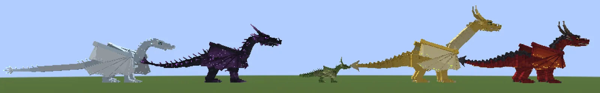 
<b>Five dragons.</b> On the <a href="https://slothmod.com/#creatures">website</a> you can look at dragons and a fairy from four sides.

<table>
  <tr>
    <td width="50%" align="center">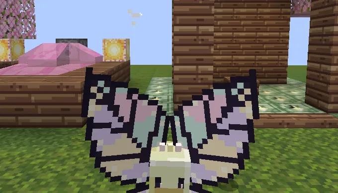 <b>A fairy with butterfly wings</b></td>
    <td width="50%" align="center">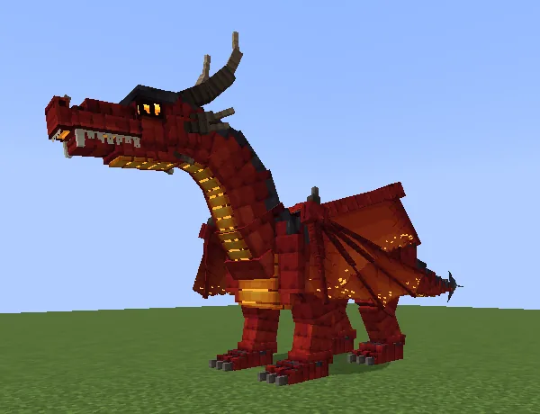 <b>A dragon with membrane wings</b></td>
  </tr>
  <tr>
    <td width="50%" align="center">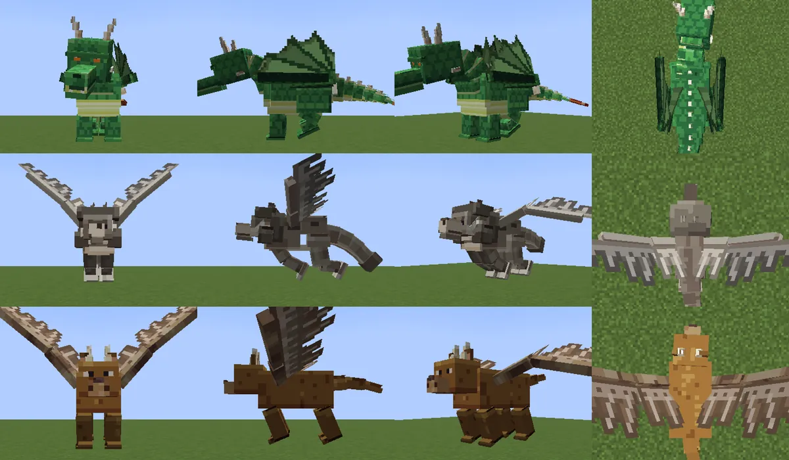 <b>Leathery and feathered wings</b></td>
    <td width="50%" align="center">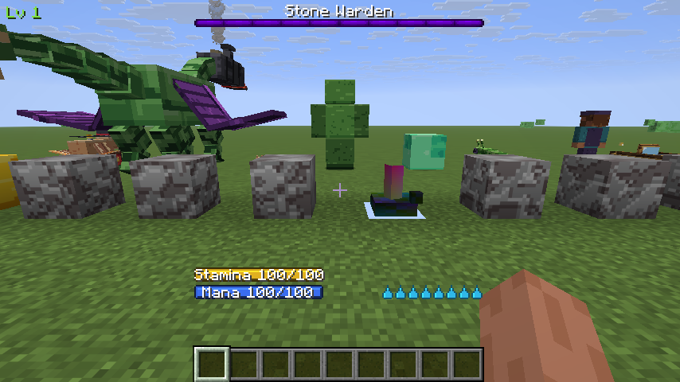 <b>Boss bars, custom HUDs &amp; creatures in Minecraft 26.3</b></td>
  </tr>
</table>

## Your first mod in 3 steps

1. **Describe it (or open a Studio).** Click **Create New Mod**, pick a Minecraft version and type what you want — for example "a ruby sword that sets mobs on fire" — or open **World Studio**, **Build Studio**, **Brain Studio**, **Colony Studio**, **Game Studio** or **Theme Studio** directly with no API key.
2. **Pick and customize the art.** Choose from several versions of each texture, 3D model and sound — or jump into **Studio** and **Blueprints** to sculpt and paint in 3D, tweak animations, edit crafting recipes and wire rules by hand.
3. **Test it in Minecraft.** One button starts the game with your mod. Then answer "Did it work?": keep it, say what is wrong so the AI fixes it, or undo.

<table>
  <tr>
    <td width="50%" valign="top">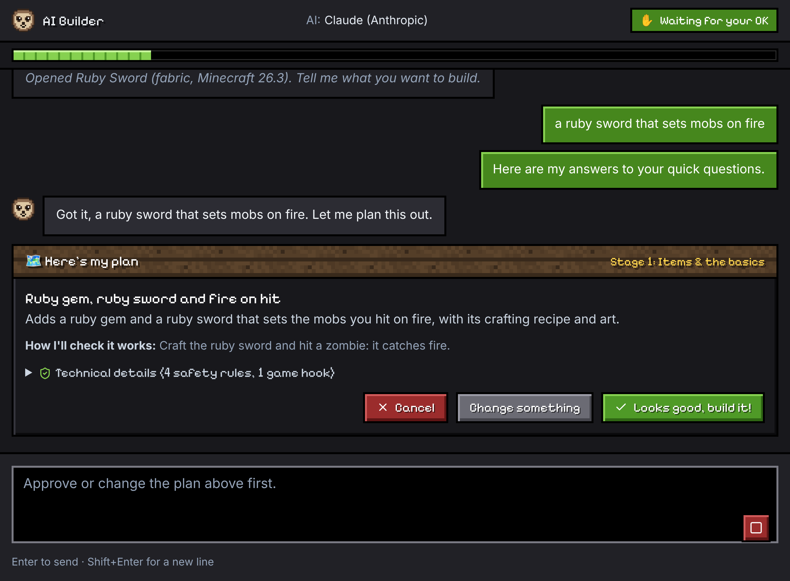 <b>A plan you approve.</b> Nothing is built before you say so.</td>
    <td width="50%" valign="top">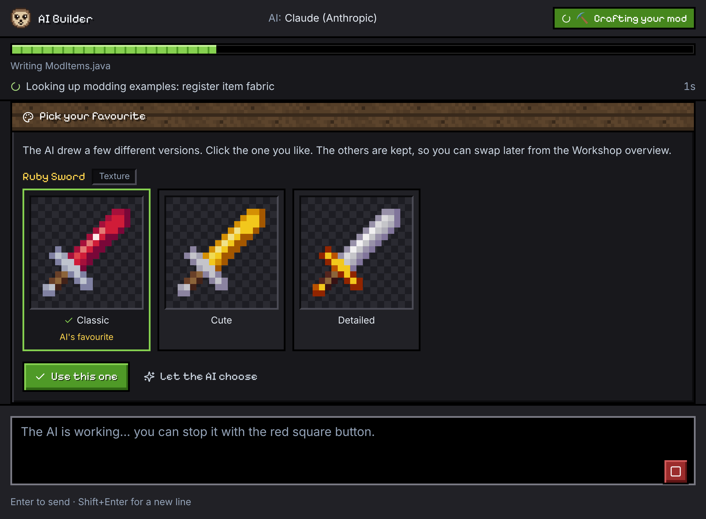 <b>Pick your favourite.</b> The others are kept for later.</td>
  </tr>
  <tr>
    <td width="50%" valign="top">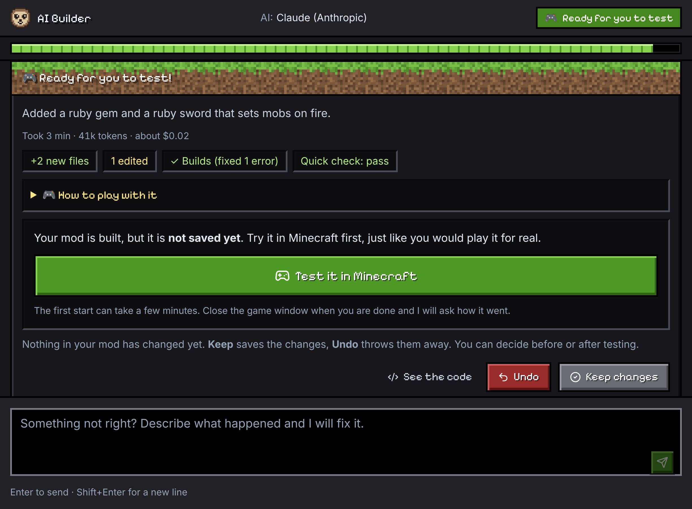 <b>Ready for you to test.</b> Your mod is saved only when you keep it.</td>
    <td width="50%" valign="top">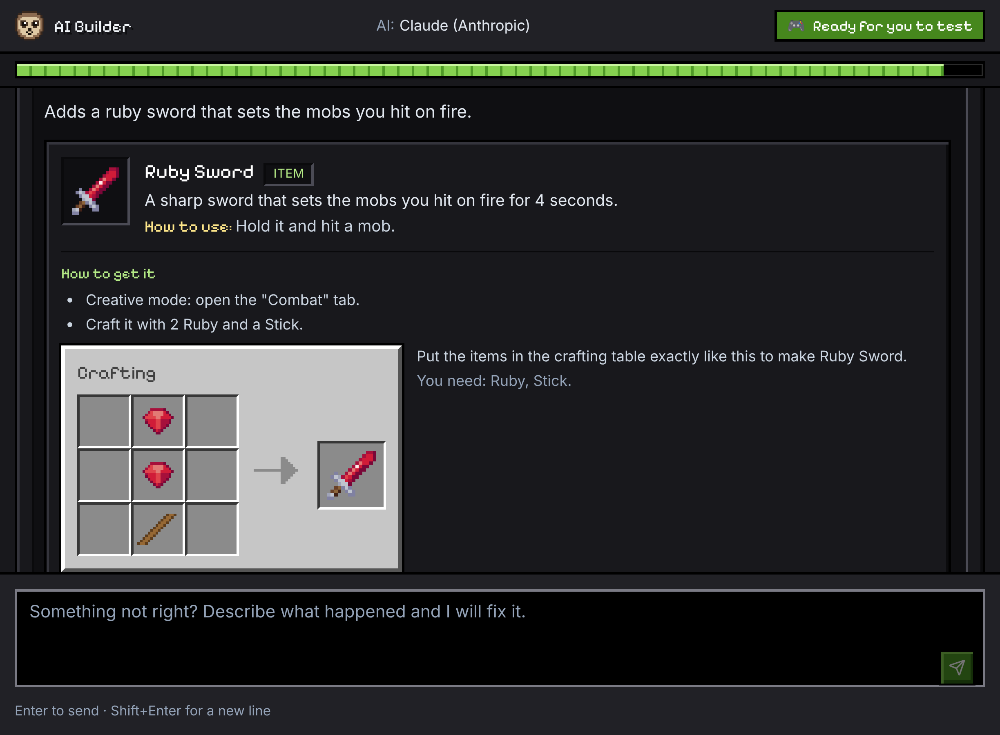 <b>A player guide</b> with crafting panels drawn like the game.</td>
  </tr>
  <tr>
    <td width="50%" valign="top">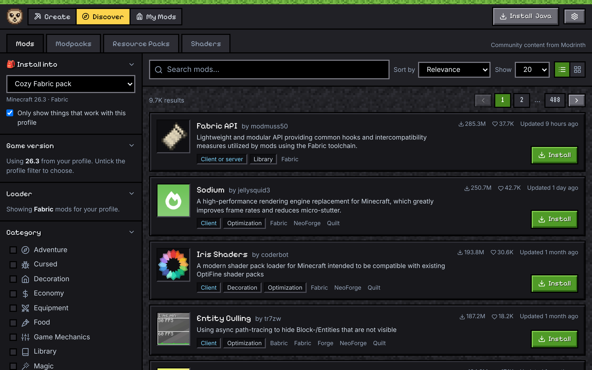 <b>Discover.</b> Mods, modpacks and shaders from Modrinth.</td>
    <td width="50%" valign="top">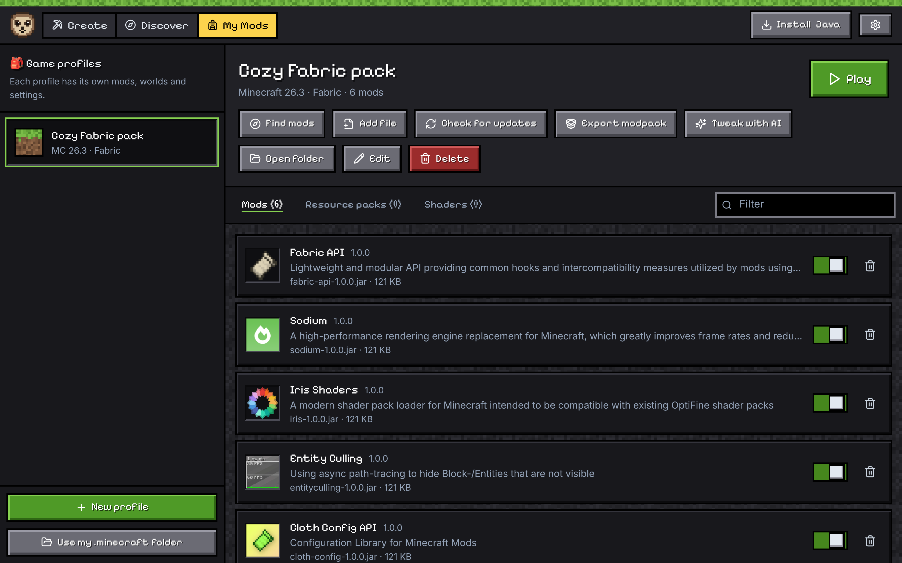 <b>My Mods.</b> Game profiles, on/off switches, updates and Play.</td>
  </tr>
</table>

## What it works with

**Minecraft versions** it builds new mods for:

| Minecraft | Fabric | NeoForge | Forge |
|:---|:---:|:---:|:---:|
| 26.3 | ✓ | ✓ | |
| 1.21.1 | ✓ | ✓ | |
| 1.20.1 | ✓ | | ✓ |

Where new things land:

| | Versions | What to expect |
|:---|:---|:---|
| **New things first** | Fabric 26.3 · NeoForge 26.3 | Everything new is built and proven here first |
| **Supported** | Fabric 1.21.1 · NeoForge 1.21.1 · Fabric 1.20.1 · Forge 1.20.1 | Works and gets fixes; new features arrive in batches with plain notes |
| **Legacy projects** | Fabric and NeoForge 26.1, 26.2 | Existing mods still open and move to 26.3 in one click |

Small updates arrive often; the app offers them by itself, and your mods, settings and keys stay as they are.

The right Java and Gradle are downloaded by the app. It never touches the Java on your PC. The mod manager also handles Quilt and vanilla profiles.

**AI providers.** Use the one you like:

| Kind | Providers |
|:---|:---|
| **Cloud** | Claude, OpenAI, Gemini, Grok, DeepSeek, Qwen, OpenRouter, Mistral, Groq, Kimi, GLM, MiniMax, Together, Fireworks, Cerebras, NVIDIA NIM, Hugging Face |
| **Local** | LM Studio, Ollama or any OpenAI-compatible server |

Your AI provider may charge you; Gemini and Mistral have free tiers, OpenRouter has free models, and a local AI costs nothing. Every provider has a **Get an API key** button with a note on cost, **Test this AI** checks that it can really drive the app, and you can set a spending limit.

## Install

1. Download [`SlothMod_1.0.0_x64-setup.exe`](https://github.com/DeusesPR/SlothMod/releases/download/v1.0.0/SlothMod_1.0.0_x64-setup.exe) (or pick a version on the [releases page](https://github.com/DeusesPR/SlothMod/releases)) and run it. It installs for your user only, with no admin prompt.
2. **Why Windows shows a warning.** SlothMod is free and not paid-signed, so Windows SmartScreen may show a blue "Windows protected your PC" box. That is normal for a free app. Click **More info**, then **Run anyway**. Only do this for an installer from this repository's Releases page. More in [PRIVACY.md](PRIVACY.md) and [SECURITY.md](SECURITY.md).

You need Windows 10 or 11 (64-bit), about 4 GB of free disk space, internet for the first setup, and Minecraft Java Edition to play what you make. The app updates itself and keeps your mods, settings and keys.

## Where SlothMod is going

Built step by step from here: even smoother large-server multiplayer polish across all overhaul systems, continued feature parity on `1.21.1` and `1.20.1`, richer in-game visual previews, and making big creations even easier on cheap, free and local AIs. No dates, on purpose.

What stays: free, Windows, works with cheap or free AI (including AI on your own PC), a compatibility check against your modpack, and safety checks on AI-written code. If you use SlothMod today, nothing breaks and updates keep coming through the app. Tell us what you want to make in the [Discussions](https://github.com/DeusesPR/SlothMod/discussions), or use **Report a problem** in the app.

## Status

**What works in this version (1.0.0):** the complete SlothMod 1.0 creation suite — **World Studio** (60 fps stepped 3D voxel terrain explorer, live 3D/2D terrain/water/surface/tree sculpting with Undo/Redo, 3D building drag-move/rotate/copy/bulldoze, `.mca` world import, drawing & OpenStreetMap real-place importers and **Pretty Light**), **Build Studio** (3D architecture composer, ornate facades, 16-room furnisher, free sketch & vision-photo importers, `.nbt`/`.schem`/`.litematic` schematic import, smart wood/stone family swap, optional 2-call 3D look review, `512+`-block mega-structures and craftable in-game Blueprint scrolls), **Brain Studio & Colony Studio** (12 `$0` pixel-art starter minds, 24-hour Calm/Raid simulator, live AI companion skills, player-run Town Hall colonies with `Lv 1–3` builders, warehouses, couriers, traits/moods, painted zones, `1–4` priorities & Storyteller events), **Game Studio & Theme Studio** (whole-game composer, 8 `$0` Instant Overhaul Worlds, living chronicles & rival warlords, seasons, dynamic markets, civic banks/laws/elections, tabletop Game Master scepters, multi-lane Tower Defense, Capture Orbs & genetics, vehicles/contraptions, engineering/power/rail/habitats, stealth/mysteries, playable music & custom 6-card pixel-art theme styling), plus **3D Sculpt**, **3D Paint & Grab**, **Keyframes** (`.bbmodel` / `.animation.json`), **Slash Commands**, **Advancement Trees**, **Game Rules**, **Villager Professions**, **Custom Biomes, Dimensions, Portals & Dungeons**, **Dialogue Graphs**, **Cutscenes**, **Procedural Music**, **World Rules**, **Workstations**, **Custom Trees**, **Open `.jar` Mod**, **Overlay Packs**, **Visual Blueprints**, **Sync to Game (`F3+T`)** and **Code** mode — compiles with real Gradle across all six active targets (`Fabric 26.3`, `NeoForge 26.3`, `Fabric 1.21.1`, `NeoForge 1.21.1`, `Fabric 1.20.1`, `Forge 1.20.1`), passes dedicated-server verification on `Fabric 26.3` and `NeoForge 26.3`, and is verified in live Minecraft client sessions with automatic in-game mod checks on `26.3` and `1.21.1`.

**Still being polished:** full unassisted start-to-finish multiplayer playthroughs across every combination of the newest overhaul systems are still being fine-tuned in real play; natural World Studio terrain generation, the newest dragon riding/camera features and some visual polish lead on `26.3` while `1.21.1` and `1.20.1` receive batch parity with plain notes in the app; portals start from the Overworld; HUD-bar hiding and damage multipliers in **World Rules** are skipped on `Fabric 1.20.1` and `Fabric 1.21.1`; and third-party `.jar` tweaking intentionally edits textures, sounds, recipes and data rather than decompiling compiled Java classes. The safety check is a strong guardrail, not a guarantee: only play mods you trust. The installer is not paid-signed, so Windows SmartScreen may show a warning.

## More details

<b>Everything it can do</b>

 

- **World Studio & 3D Voxel Terrain Sculptor (`$0` AI).** Roll continents and islands, paint biomes, rivers and world edges, convert drawings or real-world map areas (OpenStreetMap + elevation), or import existing Minecraft saves (`.mca`). Sculpt terrain, water, 8 surfaces and trees live in 3D & 2D with Undo/Redo, and drag-move, rotate, copy, bulldoze or extract existing buildings into **Build Studio**.
- **Build Studio, Ornate Facades, Room Furnisher & Blueprint Scrolls.** Build multi-part architecture and shaped-ground scenes from English (plus optional 2-call 3D look review), free floor-plan sketches, reference photos, `.nbt`/`.schem`/`.litematic` files or `$0` starters; swap wood/stone families while preserving orientation; furnish 16 room types automatically; place `512+`-block mega-structures; and build/undo structures in-game with Blueprint scrolls.
- **Brain Studio, Living Towns & Self-Building Colonies (`$0` AI).** Design townsperson minds with 12 pixel-art starter archetypes, unclamped personality sliders, memories, relationships, patrol routes and a live 24-hour simulator (plus optional live AI companions), and run self-building **Colonies** with Town Halls, Build Scepters, `Lv 1–3` builders, warehouses, couriers, worker huts, colonist traits/moods, painted zones, `1–4` job priorities and dynamic Storyteller events.
- **Whole-Game Studio & Total-Conversion Systems.** Compose complete survival overhauls in **Game Studio** or remix 8 `$0` **Instant Overhaul Worlds** — with living chronicles & rival warlords, seasons & dynamic markets, town banks/laws/elections, tabletop Game Master scepters & multi-lane Tower Defense, Capture Orbs & genetics, moving multi-block ships & elevators, conveyors/power grids/rail signals/pressurized habitats, stealth & Spirit Camera mysteries, and playable 24-note instruments.
- **Theme Studio, 3D Sculptor, 3D Paint & Keyframe Timeline.** Style your entire mod's palette, materials, wear, glow and custom `8×8` pixel stamps on a live 6-card pixel-art sample sheet; sculpt 3D props and weapons box-by-box (`1 px` or `1/4 px` snap); paint directly on 3D models with smart **Scales**, **Crystal**, **Metal**, **Fur** and **Rune Glow** brushes synced to `F3+T`; and animate creatures on a `0–200` tick **Keyframe Timeline** with `.bbmodel` / `.animation.json` clip import.
- **Custom biomes, dimensions, portals, dungeons, dialogue, cutscenes, commands & rules (`$0` AI).** Spin live 3D block dioramas for custom biomes, multi-biome dimensions, standing `4×5` portals and branching multi-room dungeons; wire 48-node branching conversations with `d20` checks, smooth camera cutscenes, quests, storylines, `/command` trees, parent-to-child advancement trees, `/gamerule` toggles, custom villager professions, survival world rules, beveled custom kilns/workstations and sapling-to-canopy custom wood-set trees.
- **Action combat, magic, bosses & creatures.** Dodge rolls, timed parries, grappling hooks, wall-running, player scale/form morphs, local time-stop, shadow clones, domain arenas, radial spell wheels with three loadouts, generation-2 guns & 3D staffs, passive skill trees, multi-move bosses with breakable limbs, rideable 8-element dragons, watched statues/stalkers, ranged mobs and custom ore veins.
- **Sound & music maker.** 614 kinds of sound (creatures, weapons, magic, materials, machines, interface, ambience, music) plus 8 seamless area & boss music loop styles, made in the app, checked for clicks and clipping, and added as real mod sounds.
- **Visual Blueprints, Code mode, `.jar` Opener & Overlay Packs.** Wire mod rules visually as colour-coded node graphs (or plain sentences), switch to dark-theme Java **Code** mode with one-click Gradle builds, reopen SlothMod `.jar` projects with art and Blueprints intact, or tweak third-party Fabric/NeoForge/Forge `.jar` mods and export `.zip` Overlay Packs.
- **Update versions, spend limits, Modrinth manager & Share.** Move mods to newer Minecraft versions while keeping custom art and edits, set per-mod or daily AI spending caps with an optional PIN, browse/install Modrinth mods/modpacks/shaders, check modpack compatibility on a throwaway server, read plain-English crash explanations, save `1200×630` showcase banner cards, or publish drafts to Modrinth.

<b>Safety and privacy</b>

 

- **A guard reads mod code, metadata and build files.** Before every build, code as well as mod metadata and resource files are scanned for things a mod should never do, like launching programs, opening web connections, running hidden commands during a build or touching files outside the game folders. The build files are locked while a mod is made, and a blocked build tells you why.
- **Nothing is kept until you say so.** The AI works on a copy of your mod. You test it, then keep or undo. Older versions stay in History.
- **No accounts, no tracking.** No sign-up, no telemetry, no analytics. Built `.jar` files include a small project bundle (your mod's own source, textures, sounds and Blueprints, with no API keys, chat history or PC folder paths; your Big Project plan stays out unless you switch it on for that mod) so you or anyone you share the `.jar` with can reopen it in SlothMod, plus an optional "Made with SlothMod" credit line you can switch off in Settings. Your requests and mod files go only to the AI provider you choose, or nowhere with a local AI. Downloads contact Modrinth, Mojang and the loader sites, and the update check contacts GitHub. Real-place world lookups contact OpenStreetMap and open elevation services only when you explicitly click to load a map area. If "Let the AI look things up online" is on (the default), the AI may read a short summary from Wikipedia or the Minecraft wiki while planning. The full list is in [PRIVACY.md](PRIVACY.md).
- **Keys stay on your PC.** API keys live in Windows Credential Manager, never in files or logs. SlothMod never sees your Microsoft login; the official launcher handles it.
- **Honest limits.** Mods are programs and the guard is a safety net, not a guarantee. Code that passes the guard still runs with your Windows rights. Only play mods you trust. How to report a security problem: [SECURITY.md](SECURITY.md). Terms in plain words: [DISCLAIMER.md](DISCLAIMER.md).

<b>Questions and answers</b>

 

**Is it free?** Yes. Free to download and use, and the mods you make are yours ([terms](LICENSE)). Your AI provider may charge; free tiers, OpenRouter's free models and local AIs exist, and all visual Studios (**World Studio**, **Build Studio**, **Brain Studio**, **Colony Studio**, **Game Studio**, **Theme Studio**, **3D Sculpt**, **Keyframes**, **Blueprints**) work offline at `$0` AI cost.

**Do I need to code?** No. You describe what you want (or use any visual Studio and **Build Manually**), click through a few choices, and customize worlds, buildings, looks, animations, crafting and Blueprints by hand. If you do like code, **Code** mode and Workshop view give you a syntax-coloured Java editor, diffs and one-click Gradle builds.

**Which AI should I use?** Any listed provider. Bigger models make bigger mods with fewer repairs. **Test this AI** in Settings checks yours.

**Is the Windows warning normal?** Yes. SlothMod is free and not paid-signed, so Windows warns about it like any new app. Make sure you downloaded it from this repository's [Releases page](https://github.com/DeusesPR/SlothMod/releases/latest).

**Mac or Linux?** The installer is Windows only.

**Is this an official Minecraft product?** No. It is a fan-made tool, not approved by or associated with Mojang or Microsoft, and it contains no Minecraft assets.

Longer answers are on the [website](https://slothmod.com/#faq).

<b>What has been tested, and what has not</b>

 

- Tested on a real Windows PC with real cloud and local AIs: mods built from plain sentences and across the visual studios were compiled with real Gradle across all six active targets (`Fabric 26.3`, `NeoForge 26.3`, `Fabric 1.21.1`, `NeoForge 1.21.1`, `Fabric 1.20.1`, `Forge 1.20.1`), verified on dedicated servers (`Fabric 26.3` and `NeoForge 26.3`, plus `1.21.1` and `1.20.1` checks), and tested in real Minecraft client sessions with automatic in-game mod checks (`Fabric 26.3`, `NeoForge 26.3`, `Fabric 1.21.1`, `NeoForge 1.21.1`).
- World Studio 3D voxel sculpting and `.mca` building copy/move, Build Studio schematic round-trips, room furnishing and in-game Blueprint scrolls, Brain Studio & Colony Studio NPC/colony runtimes, Game Studio overhaul systems, Theme Studio pixel-art mod windows, 3D sculpting, keyframe animations, commands, advancements, game rules, villager professions, custom realms/dungeons/portals, dialogue, cutscenes, procedural music, world rules, workstations, custom trees, `.jar` round-trips and Overlay Packs have been checked in real builds and game sessions, while long unassisted multiplayer Survival runs combining many systems at once are still being fine-tuned in real play.
- "Sign in with Grok" is experimental and off by default (Settings → Experimental). It signs in with the identity of xAI's own Grok CLI, which may be against xAI's terms; xAI can block it or act on your account. You must accept a warning first, and an xAI API key is the supported way.
- The installer is not paid-signed.

## Help and feedback

- **Something broke?** Press **Report a problem** in the app; it fills in a GitHub issue with your log attached and your keys and Windows name hidden. Or open a [bug report](https://github.com/DeusesPR/SlothMod/issues/new?template=bug_report.yml) by hand. Never paste API keys.
- **Ideas, questions and things you built:** [suggest an idea](https://github.com/DeusesPR/SlothMod/issues/new?template=mod_idea.yml) (or press **Suggest an improvement** in the app) or join the [Discussions](https://github.com/DeusesPR/SlothMod/discussions).
- **Want to help?** Reports and ideas are the best help right now; the [changelog](CHANGELOG.md) shows what changed.

## Support SlothMod

SlothMod is free. If it helps you, you can support it here: **[buymeacoffee.com/SlothMod](https://buymeacoffee.com/SlothMod)**

## License and credits

SlothMod is free to use; the terms are in [LICENSE](LICENSE). Everything SlothMod is built from is listed in [THIRD_PARTY_LICENSES.md](THIRD_PARTY_LICENSES.md). The pixel fonts are Pixelify Sans and VT323 (SIL OFL 1.1), and the bundled sound library is CC0 sound effects by [Kenney](https://www.kenney.nl). All art in the app and on this page is original or made by the app's own art engine.

SlothMod is not an official Minecraft product and is not approved by or associated with Mojang or Microsoft. Minecraft is a trademark of Mojang AB and Microsoft Corporation, used here only to name the game the mods are for. SlothMod contains no Minecraft assets; pictures of vanilla items are read at run time from your own game files.
